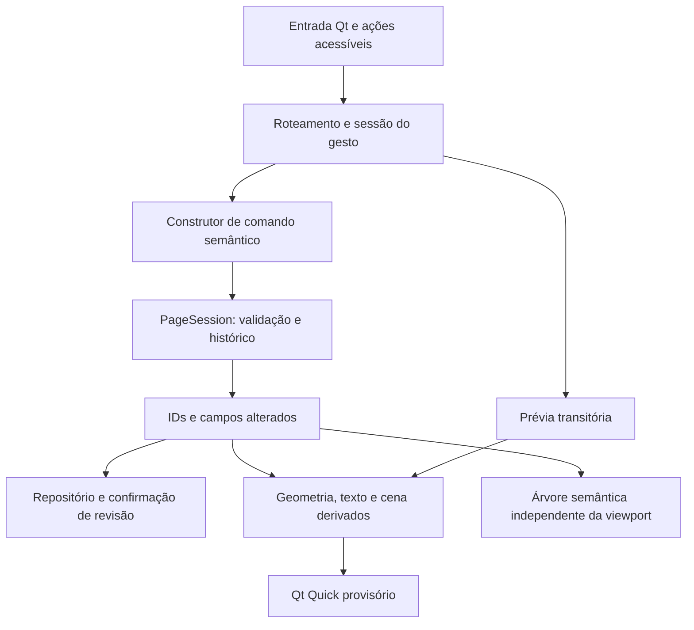

# 22 — Arquitetura do editor visual unificado

**M2 · 30/10/2026 · proposta em validação.** Revisão estática da base `25f20a2`. Não implementa recursos, altera formatos ou aprova decisões. [Atividade e evidências](../specs/002-m2-unified-editor-architecture/tasks.md). Documentos derivados: [Marco 3](20-plano-marco3-objetos-e-diagramas.md), [confiabilidade E6](21-auditoria-confiabilidade-e6.md) e [EX1](experiments/EX1.md).

## 1. Diagnóstico e grau de evidência

O núcleo existente é uma base adequada para um editor integrado. A família tipada, as unidades de página, as referências por ID, os grupos planos e o histórico atômico já resolvem parte importante do problema. A maior lacuna é a integração: a projeção visual separa cards e tinta, o adaptador só oferece operações desses dois tipos e o armazenamento recusa os demais. Recomenda-se completar essas fronteiras incrementalmente, sem reescrever o editor.

Convenções deste documento:

- **Fato observado (F):** confirmado em arquivo/símbolo ou fonte primária. A existência de teste não significa execução nesta sessão.
- **Inferência técnica (I):** consequência provável do caminho observado; risco e desempenho exigem reprodução/medição.
- **Proposta MTAN (P):** desenho sugerido, sujeito à aprovação e aos portões de implementação.

### 1.1 Estado confirmado e divergências

| Tema | Fato observado | Consequência / limite |
| --- | --- | --- |
| Etapas | [Roadmap](../specs/ROADMAP.md): E0–E4.7 no histórico; M1 aprovada, fechamento pendente | Não equivalem à aceitação de caneta, leitura por voz, seleção múltipla ou DPI físico |
| Plataformas | 06 e 10 definem beta Windows primeiro e portões posteriores Linux/macOS; M1 registra testes Linux e Windows | Pedido menciona Linux/Windows como destinos; preservar desenho multiplataforma sem anunciar suporte já aprovado |
| Conteúdo v2 | Nome conceitual; banco já é SQLite v4, texto MTNT v2, tinta MTNI v1 | Não tratar “v2” como versão única de todos os formatos |
| Lotes | `savePageChanges` já grava upserts e exclusões de um comando numa transação | Último parágrafo antigo do 16 estava defasado; não propor essa capacidade como ausente |
| Diagramas | `ShapeObject`, `ConnectorObject`, `GroupObject` existem no núcleo | Não há editor nem codecs desses tipos; losango, estilos e rótulos faltam nas structs atuais |
| Histórico | E4.7 unifica texto/tinta e retém quatro sessões recentes além da ativa | Não persiste pilhas ao reiniciar; seleção mista e anúncio por leitor de tela continuam pendentes |
| Infinito | Modelo aceita negativos; viewport só expande direita/baixo e cards são limitados a x/y ≥ 24 pt | Contrato 04 §2 não está integralmente implementado |
| Ordem | Núcleo possui `visual_order`; QML promove card selecionado e desenha toda tinta em camada separada | Contradição entre ordem persistida geral e composição atual; não confundir sobreposição básica com ordem Z arbitrária |
| EX1 | Apenas catálogo no 14 e resultados históricos no 10/12; não havia EX1.md | Protocolo criado pela M2, sem medições novas nem decisão definitiva |

### 1.2 Mapa rastreável da implementação

Os nomes abaixo são símbolos pesquisáveis na base; os links apontam para os arquivos donos.

| Ref. | Arquivo / símbolo | Observação e alcance |
| --- | --- | --- |
| F01 | [page_content.h](../core/model/page_content.h): `PageContent`, `PageObjectCommon`, `PageObjectPayload` | Vetor de sete variantes; UUID, transformação, Z, leitura, bloqueio, descrição e grupo; nenhum Qt no domínio |
| F02 | [page_content.cpp](../core/model/page_content.cpp): `validate_page`, `to_page`, `from_page`, `visual_order`, `accessible_order`, `can_transform` | Validação de página inteira; texto/tinta só transladam; conector/grupo têm transformação identidade; grupos planos recíprocos; referência de conector só a texto/imagem/gráfico/forma da mesma página |
| F03 | [page_history.h](../core/model/page_history.h) e [.cpp](../core/model/page_history.cpp): `PageSession::apply`, `execute`, `execute_merged`, `undo`, `redo` | Comandos compostos, inversão e rollback de lote inválido; limites 64 MiB estimados, 16 MiB/comando e 512 entradas; não copiar amostras para mover tinta |
| F04 | [page_editor_adapter.cpp](../apps/desktop/page_editor_adapter.cpp): `commit`, `persist`, `applyHistory`, `syncSelection` | Aplica sessão antes de gravar; grava IDs tocados; sucesso notifica QML; cache recente reutilizado apenas quando igual ao conteúdo lido; sem histórico persistente |
| F05 | Mesmo arquivo: `rebuildVisual`, `addInk`, `validTextGeometry` | Listas separadas; tinta exportada ao QML como pontos sem ID/pressão/estilo, teto visual total 50.000 pontos; entrada de mouse sem pressão/tempo/inclinação; busca linear por objeto |
| F06 | [text_card_model.cpp](../apps/desktop/text_card_model.cpp): `TextCardModel::sync`; [EditorTextCard.qml](../apps/desktop/ui/EditorTextCard.qml): `save`, `reloadDocument`, `typingIdle`, `commitMove` | Modelo incremental conserva delegates; texto temporariamente modificado no Qt; pausa de 800 ms; prévia de geometria; card selecionado usa `z: 2`, demais `z: 1` |
| F07 | [rich_text_qt.cpp](../apps/desktop/rich_text_qt.cpp): `captureQtDocument`, `populateQtDocument`; adaptador `loadRichText` | Conversão estruturada, sem HTML canônico; undo interno Qt desabilitado; caret serializado apenas no comando transitório |
| F08 | [EditorProbe.qml](../apps/desktop/ui/EditorProbe.qml): `selectedCardId`, `saveTexts`, `restoreSelection`, `penSurface` | Seleção de uma caixa; mouse desenha acima dos cards; não há seleção espacial heterogênea nem borracha implementada nesse caminho |
| F09 | [Main.qml](../apps/desktop/Main.qml): `zoomAt`, `pageScroll`, `pageCoordinates`, `panSurface` | Zoom 0,5–3; conversão ancorada com clamp da rolagem; pan central/espaço; extents de cards; crescimento positivo; perda de foco limpa `spacePan` |
| F10 | [ink_probe_item.cpp](../apps/desktop/ink_probe_item.cpp): `StrokeMesh`, `appendPoint`, `updatePaintNode` | QSG com dois nós (confirmado/ativo), triângulos em float; cor/largura fixas; descarta deslocamentos menores que 0,75 px lógicos da cena; retessela todo conjunto confirmado quando sujo e no ajuste de feather por escala |
| F11 | [page_repository.cpp](../apps/desktop/page_repository.cpp): `loadPageContent`, `prepareObject`, `savePageChanges` | Só texto/tinta sem grupo; leitura limitada a 100.000 objetos/256 MiB de payload por página, sem checagem agregada equivalente na escrita; transação de lote já existe |
| F12 | [notebook_schema.cpp](../apps/desktop/notebook_schema.cpp): `inspectNotebookSchema`, `migrateNotebookSchemaV4` | Inspeção por versão/colunas; migrações transacionais por salto, leitura de v1–v4, recusa de futura; `page_objects` só aceita text/ink |
| F13 | [notebook_store.cpp](../apps/desktop/notebook_store.cpp): `openDatabase`, `selectPage`, `closeNotebook`, `deletePage`, `deleteSection` | SQLite local, FK solicitada; flush por sinal sem resultado; exclusão de página/seção física; caderno vai para pasta trash; sem política explícita de journaling/revisão concorrente |
| F14 | [content_codec.cpp](../core/model/content_codec.cpp): `encode_text_v2`, `decode_text`, `encode_ink_v1`, `decode_ink_v1` | Formatos independentes do Qt com limites, validação e versões; pressão opcional preservada pelo codec, não pelo renderizador atual |
| F15 | [main.cpp](../apps/desktop/main.cpp), [CMakeLists.txt](../CMakeLists.txt), [workspace_quick_tests.cpp](../tests/workspace_quick_tests.cpp): `InputDriver` | Perfil isolado, captura e alvos comuns; não foi localizado pipeline de métricas ponta→tela ou quadro. `QElapsedTimer` no adaptador serve à fusão, não a benchmark |

### 1.3 O que os testes demonstram e o que não demonstram

| Arquivo | Verificações presentes por inspeção | Não inferir |
| --- | --- | --- |
| [page_content_tests.cpp](../tests/page_content_tests.cpp) | Transformação inversa, ordens, grupos inválidos, referências, bloqueios | Hit-testing ou renderer de diagramas |
| [page_history_tests.cpp](../tests/page_history_tests.cpp) | Lote inválido revertido, desconexão antes de remover nó, grupos, limites, fusão, undo/redo | Atualização visual de conectores, durabilidade em queda ou persistência das pilhas |
| [content_codec_tests.cpp](../tests/content_codec_tests.cpp) | Bytes canônicos, truncamentos, versões, UTF-8, amostras opcionais | Hardware com pressão |
| [notebook_schema_tests.cpp](../tests/notebook_schema_tests.cpp) e [page_repository_tests.cpp](../tests/page_repository_tests.cpp) | Migrações/round-trip, legado sem escrita, conteúdo inválido e futura versão sem regravação | Power-cut, FULL/IOERR, concorrência, backup, recuperação |
| [tst_editor.qml](../tests/qml/tst_editor.qml) | `test_text_and_ink_roundtrip`, `test_rich_text_roundtrip`, `test_viewport_and_infinite_page`, `test_unified_history`, `test_typing_keeps_tools_and_ime` | IME físico, leitores de tela, seleção mista, milhares de traços |
| [tst_native_ink.qml](../tests/qml/tst_native_ink.qml) | Tinta sobre texto e ponto isolado, SKIP explícito fora de sessão nativa | Cores/pressões variadas e latência real |

A M1 registra 8/8 no Windows e 76 capturas, além da execução Linux. A M2 não converte esses registros em execução própria. Resultado desta sessão e portões pendentes ficam no tasks da atividade.

## 2. Modelo de documento, sessão e cena

**P:** preservar objetos tipados por valor e composição por referências. A mesma página contém todos os conteúdos, e todos passam por um `PageSession`. Rótulo é conteúdo incorporado de uma forma/conector; card livre é entidade independente. Não transformar todo texto em filho de um diagrama nem todo traço em filho de uma caixa.

| Camada | Autoridade | Dados que não lhe pertencem |
| --- | --- | --- |
| Documento | UUID, payloads, transformações em pt, relações, Z/leitura, opções do papel | Caret, hover, mouse, GPU, pixels de fonte |
| Sessão de edição | Seleção por IDs, foco, ferramenta por dispositivo, composição IME, gesto, prévias, histórico, revisões pendentes | Uma segunda cópia permanente da geometria |
| Projeção renderizada | Bounds/layout derivados, rota resolvida, malha, caches, conjunto visível | Fonte canônica do texto/tinta ou vínculo por coincidência visual |
| Armazenamento | Snapshot confirmado e versão de esquema/payload | Preferências de hover ou objetos QML serializados |



O desenho mostra responsabilidades propostas, não novas pastas obrigatórias. A primeira extração justificada é um construtor de operações mistas e uma projeção por ID; uma interface universal de plugins ou um ECS não tem demanda demonstrada.

### 2.1 Invariantes de documento

| ID | Contrato | Estado / verificação necessária |
| --- | --- | --- |
| I01 | ID é estável ao mover/editar; novo ID ao duplicar/colar; página única; nunca usar índice da lista como identidade | Validação básica já existe; duplicação mista a testar |
| I02 | Uma única transformação local→página; bounds, rota ligada e cache reconstruíveis | Núcleo suporta; renderer futuro deve consumir a mesma geometria |
| I03 | Grupo plano, um pai, lista de filhos e `group_id` recíprocos; transformação do grupo identidade; sem camada visual | Já validado; criar/desagrupar modifica ambos os lados num comando |
| I04 | Extremo ligado aponta a alvo elegível da mesma página; excluir alvo libera extremo na última posição resolvida, no mesmo lote | Núcleo recusa órfão, mas resolução geométrica/comando semântico ainda faltam |
| I05 | Ordem visual por `(z_order,id)`; leitura por `(reading_order,id)`; agrupamento não reordena pintura | Funções de núcleo existem; QML não implementa ordem visual geral |
| I06 | Edição de texto muda seu layout, não desloca tinta nem objetos vizinhos | Preservar 04/17; rótulo incorporado só recompõe dentro do dono |
| I07 | `Esc` de gesto elimina prévia, sem DB/histórico; edição confirmada é uma operação atômica com todas as dependências | Parcial em cards; ampliar para lotes mistos |
| I08 | Todo estado aceito para salvar deve poder ser lido sob os mesmos limites e versão | Lacuna de limites agregados; E6 deve impedir gravação que torne a página ilegível |
| I09 | Falha não descarta trabalho pendente nem anuncia confirmação | Contrato de produto existente, não garantido pelo caminho atual; auditoria 21 |

**Operações:** criação valida payload/IDs antes de publicar; modificação valida a página final, incluindo referências; remoção calcula dependências antes de excluir; grupo só nasce com filhos válidos; persistência grava o estado final inteiro da operação. Erro de codec, orçamento ou referência rejeita a operação inteira. Conteúdo desconhecido não é reinterpretado nem descartado para permitir abrir.

### 2.2 Comparação de modelos

| Opção | Benefício | Custo e adequação |
| --- | --- | --- |
| Variantes tipadas + relações explícitas (atual) | Validação central, serialização previsível e undo existente | Cada tipo exige adaptar codec/geometria/render; recomendada para o conjunto conhecido |
| Composição de capacidades/ECS | Útil com grande número de combinações e sistemas independentes | Introduz estados parciais e validação entre componentes sem problema atual correspondente; rejeitar agora |
| Árvore documental de cena | Facilita hierarquias locais e clipping de contêineres | Grupos planos aprovados não precisam de transformações herdadas; faria migração e seleção mais complexas |
| Scene graph apenas de renderização | Retém recursos, permite culling e atualizações locais | Já é usado por QSG; não deve ditar o formato nem a hierarquia acessível |
| Três subdocumentos por modalidade | Isola implementações | Fragmenta Z, seleção, comandos e referências; rejeitar |

**Página:** finita é útil para aula/exportação, infinita para diagramas; expansão positiva atual é uma técnica de viewport, não terceiro formato. Preservar A4/infinita já aprovadas, corrigir o acesso a coordenadas negativas de forma incremental. A3/customizado e paginação PDF não são entregas M2. Texto A4 mantém restrição horizontal aprovada no 17; conteúdo preexistente fora do papel nunca é movido ao ler. Resolver borda de exportação no Marco 5.

## 3. Coordenadas e geometria compartilhadas

**F:** `to_page` faz escala, rotação e translação, nessa ordem; `from_page` inverte. Texto e tinta recusam rotação/escala distintas da identidade. `Main.zoomAt` compensa rolagem mas aplica clamp: a âncora pode variar na borda. A largura QML A4 usa 794 unidades lógicas, enquanto a canônica é fracionária; não usá-la como nova fonte persistida.

**P:** quatro espaços explícitos bastam: local do objeto (pt), página (pt), viewport (unidade lógica Qt) e pixels físicos do dispositivo. A cena Qt sem zoom é uma conveniência de adaptação, com fator `s=4/3`; tela global é usada somente nas APIs de janela/menu e nunca armazenada.

Para ponto local `l`, transformação `T`, zoom `z`, origem lógica de página `o` e scroll `c`:

```text
p = T(l)
v = o + (4/3) z p - c
p = (v + c - o) / ((4/3) z)
pixel físico = DPR × v     (local à superfície; não coordenada global de monitores)
```

Converter eventos na borda Qt uma vez, preservando timestamp/dispositivo. Ferramentas recebem página + posição lógica da viewport para alvos de tela. `Geometry` recebe payload/transformação/layout e produz bounds, portas e teste exato; não consulta widgets. Layout de texto é serviço Qt com métricas identificadas, entregue à projeção; não incluir Qt no núcleo.

**Testes de contrato propostos: separação entre tolerância numérica e tolerância de uso.**

1. `from_page(T,to_page(T,l))≈l` com tolerância relativa à magnitude/condicionamento; testar negativos, rotações, escalas e valores não finitos. O `1e-10` usado num caso atual não é tolerância universal.
2. Zoom/pan não altera nenhum byte de payload nem transformação. Ponto sob a âncora conserva posição na viewport quando não há clamp; na borda registrar clamp esperado. Capturar antes/depois e comparar DTO, além do pixel.
3. Drag de delta lógico `dv` gera `dp=dv/((4/3)z)`; iniciar da geometria original, sem acumular arredondamento quadro a quadro.
4. Alça/tolerância em unidades lógicas de tela fica estável sob zoom; converter tolerância para pt na consulta. DPR só governa rasterização, não duplicar sua aplicação no input.
5. Bounds de tinta incluem largura/pressão, pontas e margem de antialias; bounds de texto incluem layout, sem alças; hit bounds podem ser maiores que bounds pintados.
6. Extremo ligado resolve porta no espaço local do alvo e aplica sua transformação. Fallback é página, usado somente se livre; após excluir alvo, congelar a posição resolvida, nunca um fallback antigo.

**I:** double no documento e float absoluto na malha (F10) permitem perda de precisão em regiões distantes. **P:** medir erro ao ampliar a faixa de coordenadas; subtrair origem próxima da câmera antes de converter para float. Definir envelope operacional a partir da EX1, sem vender “infinito” como precisão ilimitada. Não mudar os doubles persistidos.

## 4. Roteamento de entrada e estados

**F:** hoje há handlers distribuídos entre Main, EditorProbe e cards; não foi encontrado adaptador dedicado de tablet, rejeição de palma ou uma máquina geral de ferramentas. Mouse sintético não prova pressão. O DTO já possui campos para pressão/tempo/tilt.

**P:** `PointerSample` na borda representa dispositivo, identidade do ponteiro, fase, posição, botões, modificadores, pressão opcional e tempo monotônico. Não preencher ausência de pressão com zero. Captura pertence a uma sessão de gesto; callbacks atrasados de outro ponteiro não confirmam o gesto ativo. Qt aceita/sintetiza eventos de tablet/mouse conforme tratamento; deduplicação precisa respeitar a origem do evento, não heurística de proximidade ([QTabletEvent](https://doc.qt.io/qt-6.8/qtabletevent.html)).

### 4.1 Prioridades propostas

| Contexto | Dono do evento | Resolução |
| --- | --- | --- |
| Modal/menu ativo | Contexto modal | Suspende ações do canvas; restaurar foco ao fechar |
| Composição IME ou texto em foco | Sessão textual para teclas | Letras, espaço e atalhos textuais não trocam ferramenta; comando de canvas requer saída explícita/ação própria |
| Gesto capturado | Sessão do dispositivo iniciador | Movimento/release seguem o dono; outro ponteiro não toma o gesto |
| Navegação temporária sem texto | Pan/zoom | Restaurar preferência anterior ao soltar; limpar teclas na perda de foco |
| Caneta com ponta/borracha | Ferramenta efetiva da caneta | Por padrão desenha/apaga tinta mesmo sobre texto/forma; Texto só se escolhido para caneta |
| Mouse | Ferramenta do mouse + hit-test contextual | Texto escolhe caracteres; seleção escolhe objetos; corpo textual nunca inicia drag da caixa |
| Touch habilitado | Navegação | Não cria conteúdo por padrão; durante contato de caneta suprimir gestos da palma; todo fluxo tem alternativa sem touch |

Os documentos 02 §3 e 03 §1 apresentam ordem diferente entre modal e texto. A síntese acima propõe escopos: modal externo vence, texto recebe suas teclas dentro do contexto ativo. Aprovar a redação antes de alterar despacho; não alterar atalhos nesta atividade.

### 4.2 Máquina de estados mínima

Separar ferramenta persistente, foco textual e gesto transitório evita a explosão de estados de um modo único. Estados de gesto propostos: `Idle`, `PressedCandidate`, `DraggingObjects`, `Resizing`, `DrawingInk`, `ErasingInk`, `SelectingRegion`, `Connecting`, `Panning`. A edição textual tem `Editing`/`Composing`; seleção espacial é conjunto de IDs com um ID principal, não o nome de uma ferramenta.

| Transição | Ação e efeito |
| --- | --- |
| Press → candidato | Resolver alvo, guardar snapshot/seleção inicial; aguardar distância de drag da plataforma para manipulação |
| Candidato → drag/resize | Criar prévia a partir do snapshot; captura exclusiva do ponteiro; nenhuma escrita |
| Movimento | Atualizar prévia e dependências/rota para exibição; snap só onde permitido |
| Release válido | Construir um comando; validar; confirmar ou conservar pendência recuperável se storage falhar |
| Esc/captura perdida | Reverter prévia e seleção temporária; zero comandos novos |
| Troca de ferramenta durante contato | P: adiar até terminar o gesto; indicação da ferramenta efetiva permanece. Alternativa “finalizar na troca” do 02 §6 exige teste de uso |
| Perda de foco | Cancelar drag/conexão parcial, limpar teclas; para tinta, P: concluir somente amostras já recebidas se há gesto válido e marcar gravação pendente; não sintetizar último ponto |
| Sair da página/app | Solicitar flush com resultado; erro barra transição e oferece recuperação; não descartar IME sem negociação com Qt |

Trocar ferramenta conserva seleção por ID. Desenhar sobre diagrama não invoca hit-test de transformação. Clique/arrasto em texto permanece seleção de caracteres; somente alça ou ação explícita move. Para caneta e mouse simultâneos, permitir hover/UI independente, mas serializar mutações concorrentes da mesma página; não aceitar dois commits de prévias baseadas na mesma revisão sem revalidação.

**Acessibilidade:** árvore semântica por `accessible_order`, incluindo objetos fora da viewport; seleção/foco/bloqueio/descrição e relações de conectores anunciáveis. Culling não remove objetos da navegação. Enter edita rótulo/texto; comandos dedicados percorrem objetos; Tab permanece circulação de controles. Testar Narrator/NVDA e Orca reais, IME, teclado ABNT2 e perda de foco. Nenhum leitor é considerado aprovado só porque `Accessible.name` existe.

## 5. Seleção espacial e manipulação

**P:** uma consulta retorna candidatos tipados `{id, part, distance, z, editable}`; `part` distingue corpo, alça, porta e trecho. Geometria não decide ferramenta e renderer não decide seleção. Primeiro bounds amplo, depois teste exato no espaço adequado; ordenar os elegíveis por contexto e ordem visual.

Prioridade em Seleção: alça da seleção ativa → extremo/porta quando conectando → objeto mais alto elegível → vazio. Texto busca conteúdo textual sob tinta; tinta/borracha não pega formas. Bloqueado continua inspecionável, mas manipulação é recusada sem mover parcialmente o resto do grupo. Acesso a sobrepostos por comando/menu com lista ordenada, sem mudar Z; atalho final ainda por aprovar.

| Operação | Contrato proposto |
| --- | --- |
| Clique / múltipla | Substituir seleção ou alternar membro com modificador configurado; foco principal explícito; preservar ordem de leitura |
| Retângulo / laço | P: interseção geométrica seleciona; laço considera tinta com largura e ponto isolado, não apenas vértices; texto é caixa espacial, não letras. Modo de contenção integral opcional fica para validação |
| Movimento misto | Um delta em pt sobre snapshot; cada membro uma vez mesmo que grupo e filho apareçam na seleção; conector dependente resolve extremos sem dupla translação |
| Redimensionamento | Texto altera largura/reflow; forma altera dimensões; tinta só translada no contrato vigente. Seleção mista com tinta não recebe escala/rotação coletiva silenciosa |
| Grupo | União de bounds, sem superfície pintada; comando mantém filhos/parentes recíprocos; seleção de grupo é unidade, entrada explícita permite inspecionar membro |
| Duplicar/colar | Novo mapa old→new para todos os membros; remapear vínculos internos; externos ficam livres na posição atual; preservar ordem relativa, atribuir nova ordem de leitura |
| Reordenar | Ordenar conteúdo pelo Z persistido; normalizar inteiros em lote quando não houver espaço, sem alterar readingOrder |
| Snap/alinhamento/distribuição | Computar delta comum a partir de bounds; snap desligado por padrão, modificador suspende só o gesto; guias derivadas do papel; sem snap em caret/tinta livre |

**Índice espacial:** começar com vetor de bounds e consulta linear como baseline, evitando recomputar layout a cada consulta. Uma tabela por ID e adjacência de conectores são índices funcionais simples, não um framework. Se EX1 mostrar custo relevante, comparar grade uniforme (atualização barata, ruim com objetos de tamanhos muito distintos), quadtree (particionamento adaptativo, custo com objetos que cruzam células) e R-tree/BVH (bounds heterogêneos, manutenção mais complexa). Escolher pela distribuição medida e custo de atualização em drag; nenhuma estrutura está aprovada por antecipação.

## 6. Renderização e desempenho

**F:** Qt Quick já faz composição retida; tinta tem malha própria, cards são `TextEdit` em `Repeater`. **I:** os gargalos candidatos são reconstrução de todos os pontos/variantes em `rebuildVisual`, nova malha confirmada por alteração e todos os documentos ricos vivos; não se pode concluir que a GPU ou Qt Quick sejam o gargalo antes do perfil.

**P incremental:**

1. Projeção por ID e revisão, preservando `TextCardModel` e editor textual focado. Invalidar apenas IDs tocados e conectores adjacentes; `pageLoaded` reservar para troca efetiva da página, em vez de recarregar toda tinta a cada mudança.
2. Renderizar conteúdo na ordem `(z,id)`. Fragmentar tinta em unidades/lotes compatíveis com essa ordem; batching não pode atravessar um card que deveria estar entre dois traços. Overlays em camada distinta, sem elevar conteúdo ao selecionar.
3. Bounds e culling antes da tesselação; nós e malhas reusáveis por traço/revisão. Dirty region cobre bounds antigo ∪ novo ∪ dependências ∪ margem. Em QSG significa atualizar nós/buffers necessários; não pressupõe que o compositor deixará de apresentar o quadro inteiro.
4. Tinta ativa separada da confirmada, com buffer incremental e tesselação limitada à cauda quando necessário; preservar amostras originais. Pressão modula a malha, com curva a validar em E5; estabilização não muda o DTO nem faz o traço saltar ao soltar.
5. Cache de texto não focado só se medição justificar. Editor focado/IME não pode ser destruído por culling. Chave inclui revisão, largura, fonte/fallback, opções de layout e DPR/zoom para raster; invalidar sem relayout ao simples pan.
6. Limitar orçamento conjunto de página, DTO, layout, buffers, histórico e páginas recentes. O limite de 64 MiB de histórico não limita o total do processo. Descartar caches reconstruíveis antes de conteúdo; recusar edição grande de maneira recuperável.

A comparação completa fica em [EX1](experiments/EX1.md): Widgets com pintura imediata dá controle de dirty regions e texto, mas exige reconstruir integração/foco; `QGraphicsView` oferece cena retida Widgets, mas outra hierarquia não elimina trabalho de modelo/acessibilidade. Quick aproveita código existente e GPU, sem garantia automática de latência. Misturar Widgets/Quick acrescenta integração de janela e composição; `QQuickWidget` hospeda Quick dentro de Widgets, não é um encaixe inverso mágico na janela QML atual. A API documenta render extra e desativação do render loop threaded nesse caminho ([Qt 6.8](https://doc.qt.io/qt-6.8/qquickwidget.html)).

Windows e Linux/Wayland exigem medições próprias: backend gráfico, driver, frequência do monitor, oclusão, VSync e escala influem. Offscreen serve a lógica/capturas compatíveis, não a GPU nem a latência física. Em DPI misto, coordenadas lógicas de janelas e posições físicas de monitores não devem ser combinadas por multiplicação global ([High DPI](https://doc.qt.io/qt-6.8/highdpi.html)).

## 7. Operações, histórico e consistência

Preservar `PageCommand` como unidade reversível. Acrescentar construtores semânticos (`MoveSelection`, `DeleteSelection`, `DuplicateSelection`, `ConnectEndpoints`) que produzam mudanças existentes; não criar outra pilha de undo para diagramas. Rótulo usa a mesma conversão rica/IME, mas pertence ao payload do dono.

| Caso | Construção do lote / invalidação |
| --- | --- |
| Mover nó | Alterar transformação; recalcular rotas derivadas dos conectores incidentes; não gravar extremos ligados como segunda autoridade |
| Excluir nó | Resolver posição das pontas antes; atualizar payloads para extremos livres; retirar relações de grupo; excluir nó; validar página final |
| Duplicar grupo | Clonar membros e grupo com IDs novos, remapear referências internas; conector externo copiado sem alvo vira livre; conectores não selecionados continuam ligados aos originais |
| Mover grupo com conectores | Aplicar delta aos membros móveis e pontas livres selecionadas; pontas ligadas derivam dos alvos. Grupo não tem transformação própria |
| Cancelar drag | Restaurar snapshot transitório; nenhum `execute`/save; seleção inicial continua coerente |
| Undo/redo | Restaurar payloads/IDs/relações e seleção por IDs; atualizar geometria e storage no mesmo conjunto de mudanças; anúncio único do comando |

**Persistência não é sinônimo de undo:** o histórico atual é volátil e limitado. Recuperação pode reconstruir o último conteúdo confirmado sem reter toda a pilha. A constituição I inclui preservação de histórico ao fechar/reabrir, mas não define sua retenção; o código atual não demonstra undo após reinício. Registrar essa lacuna e submeter seu alcance ao dono do produto, sem reinterpretar ou dispensar a constituição nesta revisão. Se for exigida pilha durável, planejar retenção/formato e testes antes de afirmar atendimento; o cache de quatro páginas não basta.

Separar fronteiras de erro: codec/validação antes da mutação; falha de comando mantém página anterior; falha de disco conserva nova versão pendente recuperável e snapshot confirmado. A estratégia concreta, revisão confirmada, escritor e confirmação de saída são propostas no [21](21-auditoria-confiabilidade-e6.md). O estado atual recarrega do banco em `dropSessionAfterFailure`; isso reduz divergência em memória, mas pode eliminar trabalho recente.

## 8. Cinco decisões prioritárias (ADR da M2)

Cada registro contém contexto, restrições, alternativas, evidência, custos, impacto, risco, recomendação, confiança, experimento e status. “Preservar” abaixo não transforma os acréscimos em aprovados.

### ADR-M2-01 — Evoluir a família tipada existente

- **Problema/contexto:** sete tipos já existem, só dois chegam ao banco/editor. **Restrições:** 04 §2.2 e 16, IDs estáveis e grupos planos.
- **Alternativas:** variantes atuais; ECS; árvore documental genérica; subdocumentos separados. **Evidência:** F01–F03/F11–F12 e testes de grupos/conectores.
- **Vantagens/custos:** reaproveita invariantes e inversão; requer implementar explicitamente codec, geometria e interação de cada tipo.
- **Consequência/impacto:** estender payloads de forma/conector, não modificar texto/tinta existentes; ampliar projeção/repositório. **Migração:** alta atenção ao novo esquema; ensaiar fixtures e recusa por leitor antigo.
- **Recomendação:** família plana tipada, rótulo incorporado, referências explícitas. **Confiança:** alta para preservar modelo, média para rótulo até prova IME/overflow.
- **Experimento:** vertical slice forma+rótulo+conector+undo+reabertura no Marco 3. **Status:** proposta; família/grupo plano já aprovados, extensões não.

### ADR-M2-02 — Um roteador com sessão explícita de gesto

- **Problema/contexto:** input distribuído e seleção de card não escalam para dispositivos e tipos. **Restrições:** corpo textual não move caixa, teclas em texto são locais, ferramenta por dispositivo prevista no 02.
- **Alternativas:** handlers independentes por tipo; modo global rígido; roteamento contextual com captura. **Evidência:** F08–F09, conflitos documentais 02/03 e referência tldraw em §9.
- **Vantagens/custos:** cancelamento e prioridades testáveis; exige extração cuidadosa sem quebrar foco/IME.
- **Consequência/impacto:** sessão transitória comum, seleção por IDs, delegação de edição ao Qt; substituir progressivamente decisões duplicadas em QML. **Migração:** nenhuma de dados, risco alto de regressão de input.
- **Recomendação:** roteamento contextual e máquina pequena por gesto; não guardar seleção dentro da ferramenta. **Confiança:** alta no isolamento, média em caneta/touch.
- **Experimento:** EX2/EX7, perda de captura, mouse+caneta e palma em E5. **Status:** proposta; regras de tecla simples preservadas.

### ADR-M2-03 — Geometria e ordem compartilhadas, índice só após medir

- **Problema/contexto:** bounds/hit-test/rotas precisam concordar; composição atual não respeita Z geral. **Restrições:** pontos, readingOrder independente, tinta só translada, 13 descreve promoção de card selecionado.
- **Alternativas:** geometria duplicada por renderer; cena genérica; serviço derivado por tipo e bounds lineares, depois índice. **Evidência:** F02/F05/F06/F09/F10.
- **Vantagens/custos:** previsibilidade entre tela, seleção e futuro PDF; demanda separar chrome do conteúdo e invalidar dependências.
- **Consequência/impacto:** manter transformação canônica, resolver portas e ordem em uma projeção; proposta de elevar somente overlays. **Migração:** nenhuma para bounds; novos estilos/portas dependem do formato do Marco 3.
- **Recomendação:** geometria derivada e ordenação comum; não instalar R-tree agora. **Confiança:** alta na separação, média na escolha de índice e limites extremos.
- **Experimento:** EX1 mede hit-test/culling; galeria sobrepostos compara promoção atual e overlay. **Status:** proposta; conflito 13 §6.1 versus 04 §5 requer decisão explícita antes de mudar comportamento.

### ADR-M2-04 — Continuar Quick provisoriamente

- **Problema/contexto:** decidir motor sem medir carga mista causaria retrabalho. **Restrições:** moldura Quick aprovada, domínio independente, EX1 condicionada a EX2/EX4/EX7.
- **Alternativas:** QSG atual incremental; Widgets/QPainter ou Graphics View; composição híbrida. **Evidência:** F06/F10/F15, resultados históricos da M1, documentação Qt e matriz EX1.
- **Vantagens/custos:** reaproveita integração e cena retida; limites atuais de tesselação/texto precisam de perfil. Widgets pode ajudar texto/IME, mas não tem vantagem medida.
- **Consequência/impacto:** medir baseline e corrigir custos locais antes de concluir inadequação do motor. **Migração:** nenhuma agora; trocar motor depois exigirá equivalência de foco/acessibilidade/cores/entrada.
- **Recomendação:** candidato A; ensaiar B se falhar portão após melhoria localizada comprovável. **Confiança:** média, sem dados de carga nem Wacom.
- **Experimento:** [EX1 completo](experiments/EX1.md). **Status:** dependente de experimento; não decidido.

### ADR-M2-05 — Revisão confirmada e trabalho pendente recuperável

- **Problema/contexto:** flush sem resultado e recarga por erro conflitam com preservação. **Restrições:** SQLite existente, I08/I09, sem promessa absoluta de durabilidade.
- **Alternativas:** recarregar/descartar como hoje; manter operações síncronas com fronteira explícita; escritor assíncrono serializado e fila limitada. **Evidência:** F04/F11/F13 e riscos R01–R04 do 21.
- **Vantagens/custos:** protege conteúdo e torna “Salvo” auditável; fila assíncrona exige revisão, reentrada, confirmação e backpressure.
- **Consequência/impacto:** primeiro corrigir retenção/flush/limites com I/O atual; extrair escritor somente se latência medir necessidade; revisar store e adapter em atividade E6. **Migração:** revisão persistida/recuperação exige esquema futuro e fixtures; não confundir com MTNT v2.
- **Recomendação:** snapshot confirmado + pendências, uma transação por unidade lógica, saída com resultado; testar falhas antes de expandir tipos. **Confiança:** alta no problema/contrato, média na política de journaling.
- **Experimento:** DX1/DX3/RX1–RX3/QX6 e comparação de modos SQLite no 21. **Status:** proposta de implementação do contrato de preservação já vigente.

## 9. Referências externas e aplicabilidade

Consultadas em 30/10/2026. São fontes primárias, não benchmarks comparativos. Produtos proprietários permitem observar comportamento público; suas estruturas internas não foram inferidas. Links móveis devem ter revisão/versão fixada quando usados para implementação. As recomendações desta coluna são propostas MTAN.

| Referência e fato observado | Problema resolvido | Aplicabilidade, limites e recomendação |
| --- | --- | --- |
| [Excalidraw, types.ts](https://github.com/excalidraw/excalidraw/blob/master/packages/element/src/types.ts): tipos discriminados, IDs, bindings, texto com containerId, pontos/pressões separados | Relações e conteúdo serializável | Adaptar identidade/referências; não copiar seu formato nem índices de colaboração, nem tratar texto simples como equivalente ao DTO rico MTAN |
| [tldraw Shapes](https://tldraw.dev/sdk-features/shapes): registro por forma e utilitário de geometria/interação/render | Tipos extensíveis com responsabilidades identificáveis | Adaptar separação de responsabilidades; não adotar SDK web, árvore parental ou sistema de plugins inteiro |
| [tldraw Bindings](https://tldraw.dev/sdk-features/bindings): ciclo de vida trata isolamento/exclusão | Evitar dependências órfãs | Adaptar fechamento de relações dentro do comando MTAN; não executar callbacks ocultos após commit |
| [tldraw StateNode](https://tldraw.dev/reference/editor/StateNode): árvore de estados com eventos de ponteiro/teclado/cancelamento | Tornar ferramentas previsíveis | Adaptar sessão de gesto pequena; rejeitar transplante de toda hierarquia de estados |
| [FigJam, guia oficial de diagramas](https://www.figma.com/figjam/how-to-use-figjam-to-make-diagrams/): formas, rótulos e conectores ajustáveis ligam objetos | Fluxo rápido de diagramas | Investigar descoberta de conexão e edição de rótulo; nenhuma conclusão sobre armazenamento, engine ou algoritmos internos |
| [OneNote, contêineres](https://support.microsoft.com/en-us/onenote/onenote-help-and-learning/work-with-note-containers): caixas podem ser movidas/redimensionadas na página | Texto livre sem documento linear | Preservar card independente; não adotar fusão automática/Shift sem estudo, nem prometer importação .one |
| [Xournal++, preferências de input](https://xournalpp.github.io/guide/config/preferences/): classes de dispositivo e ajustes próprios, diferenças de botões Windows Ink | Hardware heterogêneo e ferramentas por dispositivo | Adaptar classificação e testes reais; não copiar opções avançadas para MVP nem garantir eventos que CTL-672 não emite |
| [draw.io, conectores](https://www.drawio.com/docs/manual/connectors/) e [waypoints](https://www.drawio.com/docs/manual/connectors/waypoints-connectors/): extremos, caminhos e pontos intermediários editáveis | Diagrama permanece legível ao reorganizar | Adaptar portas/reconexão; iniciar reto e ortogonal simples; rejeitar roteamento avançado de obstáculos no primeiro corte |
| [Qt Quick scene graph](https://doc.qt.io/qt-6/qtquick-visualcanvas-scenegraph.html) | Composição retida com geometria customizada | Preservar QSG como candidato; capacidade da API não mede desempenho do MTAN |
| [SQLite atomic commit](https://sqlite.org/atomiccommit.html) | Atomicidade sob pressupostos do SO/armazenamento | Adotar transações e ensaios de falha; não afirmar proteção contra qualquer disco/energia; detalhes e fontes no 21 |

## 10. Cenários integrados como provas de contrato

Todos são roteiros futuros, não resultados. A galeria continua sendo o ambiente; fixtures e pontos de captura entram em atividades de implementação, sem novos modos/flags.

### A — Estudo de árvores AVL

**Componentes:** sessão textual, formas/rótulos, resolvedor de portas, ferramenta de tinta, seleção mista, PageSession, repositório. **Fluxo:** escrever explicação → confirmar rajada → criar nós/arestas por comandos → mover nó em prévia com arestas derivadas → confirmar → desenhar rotação → selecionar nós/traços → mover conjunto → undo/redo → reabrir.

**Operações/invariantes:** I01–I09; mover nó altera sua transformação, não IDs; grupo move anotações sem reflow; duplicação não aparece nesse cenário. **Falhas:** texto pendente ao trocar ferramenta; falta de codec de forma; dupla aplicação de delta em conector; tinta não renderizada por limite. **Esperado:** uma história, vínculos restaurados, bytes/coords preservados, erro visível sem perda. **Prova:** testes de lote, integração SQLite e UI; capturas propostas `mixed-avl-before`, `mixed-avl-moved`, `mixed-avl-reopened` na seção Editor. **Contradição atual:** modelo aceita nós, storage os recusa; cenário não pode ser aprovado hoje.

### B — Fluxo de autenticação por teclado

**Componentes:** comandos acessíveis, foco/IME, formas com rótulo, conectores, grupos, clipboard, viewport. **Fluxo:** comando Inserir forma → digitar rótulo → comando Criar conectado → escolher direção/alvo → editar próximo → agrupar/duplicar → anotar → zoom/pan → reabrir.

**Operações/invariantes:** mapa de IDs na duplicação; vínculos externos liberados; readingOrder preservada ao mover; Tab não cria conteúdo no modo normal. **Falhas:** IME dispara atalho; label e forma disputam drag; foco perdido após undo/remoção. **Esperado:** criar/conectar sem mouse por ação nomeada; Enter edita e Esc sai; leitor anuncia dono/rótulo/conexões. **Prova:** teste Qt de sequência, leitor real por plataforma e captura `keyboard-flow-reopened`. **Contradição candidata:** Tab para criar nó conflita com 03; hipótese deve ser testada separadamente, nunca ativada globalmente.

### C — Escrita contínua com Wacom

**Componentes:** adaptador de dispositivo, captura, malha ativa, comandos de tinta/borracha, índice geométrico, escritor. **Fluxo:** contatos contínuos → alternar ponta/ferramenta de borracha disponível → selecionar/mover tinta → escrever sobre texto/formas → navegar → undo/redo → continuar.

**Operações/invariantes:** amostras originais/pressão opcional preservadas; caneta não arrasta forma; apagar gera um comando por gesto; pan não modifica documento. **Falhas:** mouse sintetizado duplica traço, palma inicia pan, flush bloqueia UI, teto visual oculta tinta. **Esperado:** sem ponto final inventado e sem salto pós-release; selecionar não altera Z. **Prova:** PX1–PX4, EX1 com carga/latência física e captura `pen-over-diagram`; registrar modelo/driver e pressão exposta. **Contradição atual:** entrada MouseArea e malha de largura fixa não aprovam esse cenário.

### D — Interrupção de persistência

**Componentes:** sessão, fila/revisões propostas, SQLite, migrador, recuperação/status. **Fluxo:** comando misto → preparar → begin → escrever objetos/relações → commit → confirmar UI; interromper em cada fronteira.

**Operações/invariantes:** nenhuma metade de grupo/conexão; reabrir revisão anterior ou nova inteira; confirmar só revisão efetivamente gravada; pendente não vira Salvo. **Falhas:** erro SQL, commit ambíguo, falta de energia, troca externa. **Esperado:** revalidar revisão, conservar pendência, oferecer recuperação sem sobrescrever original. **Prova:** matriz de falhas do 21, integridade SQL e validação de domínio, captura proposta `save-error-pending` na seção Editor. **Contradição atual:** recarga em erro e flush sem veto não satisfazem preservação do pendente.

## 11. Evolução sem abstrações prematuras

Novas formas devem acrescentar variante/parâmetros, geometria, codec e operações explícitas. Objetos compostos primeiro usam grupos planos; só justificar árvore se clipping, transformações herdadas ou edição de contêiner real exigirem. Templates são cópia/remapeamento de subgrafo; não exigem linguagem de plugins. Exportação compartilha geometria/conteúdo e exclui overlays; não captura o QML como documento. PDF anotável exige referência própria do Marco 4. OCR pode produzir texto/descrição como operação separada sem substituir tinta. Sincronização futura exigirá conflitos/revisões/operações entre réplicas; UUID sozinho não resolve, e CRDT não é requisito atual.

### 11.1 Sequência de engenharia recomendada

| Etapa | Objetivo, justificativa e pré-requisito | Componentes / escopo permitido e excluído | Aceitação, testes, evidência e risco |
| --- | --- | --- | --- |
| Encerramento M1 | Manter T030/Editor Windows; não reabrir sua aprovação | CI/galeria da M1, fora da M2 | Evidências previstas na M1; risco de confundir revisão documental com encerramento |
| E4.8 | Medir baseline, EX2/4/7, antes de escolher motor | Editor atual + instrumentação em testes/galeria; sem diagrama final | EX1, leitor e plataformas; risco de baseline truncado por 50.000 pontos |
| E6, primeiro corte | Bloquear perda de pendente e escrita não reabrível; depende da aprovação da auditoria | Store, adapter, repository, status; sem troca de engine | R01–R04 e revisão confirmada do 21; risco de reentrada/falha |
| E6 restante | Recuperação/migração/concorrência/carga de hierarquia | Persistência e diagnósticos; sem sync cloud | DX1/3/4, RX1–3, QX6; scripts futuros isolados, dados íntegros |
| E7 | Manter posição vigente no roadmap | Acabamento e acessibilidade transversal; sem absorver Marco 3 | Portões existentes, sem remover proteção de dados |
| Marco 3, fundações | Geometria, seleção por IDs, ordens, comandos e formato após E6/E7 | Cortes M3.1–M3.3 do 20; sem ECS/roteador avançado | Testes de invariantes, galeria e round-trip; risco de foco/Z |
| Marco 3, recursos | Formas → conectores → grupo/clipboard → produtividade | Cortes M3.4 em diante do 20; sem auto-layout/OCR/sync | Cenários A/B e carga mista EX1; nenhuma etapa se fecha só pelo desenho |
| E5 quando houver Wacom | Entrada real e PX1–4; não depende de terminar Marco 3 | Caneta/borracha e dispositivo; sem simular aprovação por mouse | Cenário C; bloqueia beta, não a investigação |
| Marcos 4–6/E8 | PDF, restauração portátil, exportação e distribuição | Planos vigentes; extensões só com atividade | Cenário D e fidelidade PDF; suporte por plataforma comprovada |

Não há evidência para reescrita total. Um bloqueio real em EX1 pode justificar substituir a superfície, mantendo modelo, codecs, comandos e persistência.

## 12. Decisões para o dono do produto

1. **Ordem ao selecionar:** recomendar elevar apenas alças/overlays; preserva 04 §5, mas revisa a promoção do card descrita no 13 §6.1. Comparar sobrepostos na galeria antes de mudar.
2. **Rótulo:** recomendar conteúdo rico incorporado à forma/conector, sem ID espacial próprio; impede separar rótulo por acidente. Aprovar limites de overflow e edição no 20 antes do novo formato.
3. **Fluxo conectado por teclado:** recomendar ação nomeada com atalho configurável, mantendo Tab para foco. Testar a hipótese de Tab apenas em contexto explicitamente ativado, se desejado.
4. **Borracha inicial e seleção regional:** recomendar traço inteiro e seleção por interseção, com indicação clara; parcial/contenção alternativa após prova de uso. Não está aprovada só por estar neste plano.
5. **Persistência e escopo da beta:** recomendar corrigir retenção/flush/limites no primeiro corte E6; decidir orçamento de perda de edição ainda não confirmada e política para unidades removíveis/nuvem após ensaios. “Salvo” não deve cobrir estados pendentes.
6. **EX1:** aprovar máquina de referência e objetivos medidos; recomendar manter Quick até os portões, sem autorização prévia para migração. Números finais dependem da baseline.
7. **Retenção do histórico:** explicitar o alcance da constituição I para reinício do aplicativo; recomendar primeiro garantir conteúdo confirmado e recuperação do pendente em E6, mantendo undo de sessão como fato atual. Se o contrato exigir undo após reinício, isso precisa de entrega própria antes de declarar o portão atendido; uma eventual alteração da constituição exige aprovação e emenda, não inferência da M2.

### 12.1 Respostas do dono do produto (30/10/2026)

| Nº | Decisão | Pendente |
| --- | --- | --- |
| 1 | Aceita: elevar só alças/overlays; selecionar não muda o desenho. Comparar as duas versões na galeria antes de mudar. Camadas seguem o 04 §5: um `zOrder` único por página, sem painel de camadas visível, com trazer à frente/para frente de tudo e enviar para trás/para trás de tudo | — Decisão final, sem comparação prévia: o card selecionado não sobe nem durante a edição. Aplicação e caso na galeria no corte M3.2 do [20](20-plano-marco3-objetos-e-diagramas.md) |
| 2 | Aceita: rótulo incorporado à forma/conector. Texto que não cabe faz a forma crescer para baixo, com largura fixa; o usuário ajusta com o tamanho da fonte ([20 §2](20-plano-marco3-objetos-e-diagramas.md)) | — |
| 3 | Aceita: ação nomeada com atalho configurável; Tab mantém o foco. Alternativa guardada no [ideias](ideias.md), para o caso de a ação não agradar no uso | — |
| 4 | Aceita: borracha de traço inteiro e laço por interseção primeiro; borracha parcial depois | — |
| 5 | Aceita: E6 começa por R01–R04 (retenção do pendente, flush ao sair, limites simétricos, concorrência) | Política para nuvem/removível após ensaio |
| 6 | Aceita: Quick continua até os portões da EX1; referência principal é o PC Windows do dono do produto (i5-7400, GTX 1660) e pior caso é o notebook Samsung com Linux e vídeo integrado ([EX1](experiments/EX1.md) §2) | Configuração do notebook e metas numéricas, na E4.8 |
| 7 | Aceita: primeiro garantir que nada se perde; desfazer após reinício, se desejado, vira entrega própria e exige emenda da constituição | — Decidido: esclarecer. Constituição 1.2.1 diz que o desfazer é de sessão ([M3](../specs/003-m3-constitution-undo-scope/spec.md)); desfazer persistente em [ideias](ideias.md), depois da beta |

As escolhas técnicas que apenas completam invariantes vigentes não precisam virar novas preferências de produto. As questões acima afetam comportamento, dados ou custo de migração e têm documentos donos identificados na atividade.
