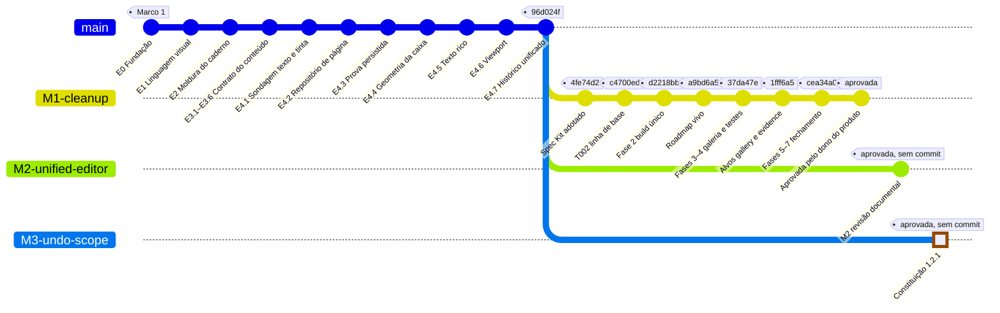
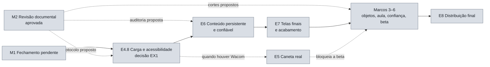

# Roadmap vivo

Mostra onde o projeto está, o caminho percorrido, os desvios e o que vem a seguir. É atualizado **em texto, checklist e gráfico** a cada mudança de estado de uma atividade, conforme o [fluxo](../.specify/workflow.md) e a [constituição](../.specify/memory/constitution.md) (II). Os marcos e critérios de produto continuam no [09](../docs/09-roadmap-beta.md), e a ordem e os experimentos no [14](../docs/14-plano-de-evolucao-e-experimentos.md). Este arquivo registra a **execução**.

Os gráficos são Mermaid. O GitHub os desenha; no VS Code, a prévia de Markdown precisa da extensão *Markdown Preview Mermaid Support*.

## Onde estamos

- **Atividade ativa:** [M3 — Alcance do desfazer na constituição](003-m3-constitution-undo-scope/tasks.md), aprovada em 30/10/2026; falta só o commit. **M2 aprovada** em 30/10/2026: [Revisão arquitetural do editor visual unificado](002-m2-unified-editor-architecture/tasks.md), exclusivamente documental; falta só o commit. Entregas: [arquitetura](../docs/22-arquitetura-editor-visual-unificado.md), [Marco 3](../docs/20-plano-marco3-objetos-e-diagramas.md), [auditoria E6](../docs/21-auditoria-confiabilidade-e6.md) e [EX1](../docs/experiments/EX1.md). check.sh passou; suíte não iniciou por CMake indisponível no PATH. Todas as decisões do dono do produto registradas no 22 §12.1.
- **M3 aprovada:** [Alcance do desfazer na constituição](003-m3-constitution-undo-scope/tasks.md), emenda 1.2.1 do princípio I (desfazer é de sessão), aberta pela decisão 7 da M2. Só texto. Não tem relação com o Marco 3.
- **M1 preservada:** [Limpeza e ambiente único de validação](001-m1-cleanup-and-validation/tasks.md), **aprovada** em 29/10/2026; fechamento ainda depende do CI Linux/Windows (T030) e da seção Editor no Windows pelo dono do produto. M2 não encerra nem assume essas verificações.
- **Linha principal parada em:** E4.7, commit `96d024f`.
- **Próxima no roadmap:** E4.8 Carga e acessibilidade, após o fechamento pendente da M1; as decisões da M2 já foram aprovadas e orientam a E4.8, a E6 e o Marco 3.

## Caminho percorrido

O tronco `main` é a sequência do roadmap. Cada manutenção (`M`) ou desvio (`C`) é um ramo que sai do ponto onde surgiu e volta ao fechar. O destaque marca o ponto em andamento. Etiquetas com hash são commits reais; o nó da M2 representa estado documental, explicitamente sem commit.



## Caminho à frente



## Checklist

### Concluído

- [x] **E0 Fundação:** toolchain, modelo inicial, persistência da hierarquia, presets, Docker e pacote portátil (Marco 1)
- [x] **E1 Linguagem visual base:** fontes, ícones, tokens e galeria ([VX1](../docs/experiments/VX1.md))
- [x] **E2 Moldura do caderno:** validada no Linux
  - [ ] Fala com Orca confirmada
  - [ ] VX13 com dois monitores físicos
  - [ ] Windows: Narrator/NVDA, DPI misto e ZIP em PC limpo (PL1). Roteiro na [parte 2 do roteiro Windows da M1](001-m1-cleanup-and-validation/checklists/validation.md#roteiro-windows-t030t031)
- [x] **E3.1–E3.6 Contrato do conteúdo:** núcleo, comandos, codecs, migração e CI Linux/Windows
- [x] **E4.1–E4.7 Prova do editor:** implementação local, de E4.1 (sondagem) a E4.7 (histórico unificado)
  - [ ] Validação manual no Windows, DPI físico, leitor de tela e pinça de touchpad
  - [ ] E4.7: histórico de seleção múltipla, comandos agrupados e leitor de tela anunciando o passo desfeito
  - [x] Suíte completa sobre E4.7: 8/8 e 12/12 casos de interface, em offscreen e Wayland (M1, T002)

### Em andamento

- [x] **M3 Alcance do desfazer na constituição** ([spec](003-m3-constitution-undo-scope/spec.md), [tarefas](003-m3-constitution-undo-scope/tasks.md)): emenda 1.2.1 aprovada em 30/10/2026
- [x] **M2 Revisão arquitetural do editor visual unificado** ([spec](002-m2-unified-editor-architecture/spec.md), [tarefas](002-m2-unified-editor-architecture/tasks.md))
  - [x] Investigação do código e fontes primárias: 22 F01–F15 e §9
  - [x] Arquitetura, Marco 3, protocolo EX1 e auditoria E6 redigidos como propostas
  - [x] Convergência documental e check.sh; evidências em T008–T012
  - [ ] Suíte completa nesta sessão: cmake indisponível, nenhum teste iniciado
  - [x] Aprovação do dono do produto (30/10/2026)

- [ ] **M1 Limpeza e ambiente único de validação** ([spec](001-m1-cleanup-and-validation/spec.md), [tarefas](001-m1-cleanup-and-validation/tasks.md))
  - [x] Fase 1: preparação e linha de base
  - [x] Fase 2: build único (presets de workflow, `asan`, `desktop_core`, ambiente por máquina, alvos `gallery` e `evidence`, CI)
  - [x] Fase 3: testes independentes (4 arquivos, perfil por arquivo, erros de QML como falha, `SKIP` explícito)
  - [x] Fase 4: galeria como ambiente único (índice, `--gallery=<seção>`, Em validação, Editor, captura roteirizada)
  - [x] Fase 5: pastas e artefatos (`build/` só com presets, `preview/` retirado, branches, nomes em inglês)
  - [x] Fase 6: documentação e regras (`BUILDING.md`, READMEs, roadmap, constituição 1.2.0, `check.sh`)
  - [x] Aprovação do dono do produto na galeria (29/10/2026, sem observações)
  - [x] Roteiro Windows, parte 1, pelo agente (T032): 8/8, 76 capturas, tinta nativa sem `SKIP`, galeria visível
  - [ ] Fase 7: fechamento. Faltam o CI Linux e Windows verdes com os artefatos (T030) e a seção Editor no Windows, conferida pelo dono do produto ([roteiro](001-m1-cleanup-and-validation/checklists/validation.md#roteiro-windows-t030t031))

### Próximo

- [ ] **E4.8 Carga e acessibilidade**
  - [ ] Revisar/aplicar [protocolo EX1 da M2](../docs/experiments/EX1.md), medindo primeiro o conteúdo já suportado; revalidar carga mista no Marco 3
  - [ ] Medir 2.000 traços, muitos cards, memória, latência e quadro (EX4, QX5)
  - [ ] Navegação e anúncios por leitor de tela (EX7)
  - [ ] Decidir entre Qt Quick e canvas Widgets (EX1, com EX2, EX4 e EX7) e fechar EX8
  - [ ] Validar a prova manualmente no Windows; critério de saída do Marco 2 sem caneta
- [ ] **E5 Caneta real**, quando o Linux enumerar a Wacom: PX1–PX4 e VX15; completa o Marco 2
- [ ] **E6 Conteúdo persistente e confiável:** autosave transacional, “Salvo” honesto, D5, DX1, DX3, DX4, RX1–RX3 e QX6; [auditoria M2](../docs/21-auditoria-confiabilidade-e6.md) propõe priorizar retenção, flush com resultado, limites e concorrência
- [ ] **E7 Telas finais e acabamento:** Biblioteca final, janela estreita, teclado de ponta a ponta, atalhos nos tooltips, reduzir movimento, contraste, reescrita do 01 e QX3
- [ ] **Marco 3** Objetos e seleção espacial (T3.1); [plano M2](../docs/20-plano-marco3-objetos-e-diagramas.md), pendente de aprovação
- [ ] **Marco 4** Fluxo de aula com PDF, busca e links (T3.2, T2.3)
- [ ] **Marco 5** Confiança, recuperação e saída em PDF (T4.1, DX2, MX7)
- [ ] **Marco 6** Beta fechada Windows (T5.1, UX2)
- [ ] **E8 Distribuição final:** instaladores Windows e `.deb`, GitHub Releases, RX4 e RX5

### Pendências transversais

- [ ] QX1: checks obrigatórios na `main` (configuração do GitHub)
- [ ] VX8: nome exibido no app, antes de distribuição pública
- [ ] Licença do projeto, antes de contribuições externas
- [ ] QX4: repetir as medições Linux para fixar um limite de regressão
- [ ] Zoom pela roda falha no teste nativo Wayland conforme o estado da janela; passa em offscreen (M1, T012). Abrir desvio se aparecer no uso

## Como atualizar

| Momento | Texto | Checklist | Gráfico |
| --- | --- | --- | --- |
| Abrir atividade | “Onde estamos” | Item novo em “Em andamento” | `branch` para M ou C, a partir do ponto de origem; roadmap no tronco |
| Concluir uma fase do `tasks.md` | “Onde estamos” | Marcar a fase | `commit` no ramo com o hash como `tag`; o ponto atual leva `type: HIGHLIGHT`, retirado do anterior |
| Passar a **em validação** | “Onde estamos” | — | Etiqueta “em validação” no último commit |
| Fechar (aprovada) | “Onde estamos” e próxima | Mover para “Concluído”, com pendências de plataforma como subitens abertos | `checkout` do ponto de origem e `merge` do ramo; atividade de roadmap vira `commit` no tronco |
| Descartar ou bloquear | Motivo | Riscar o item com o motivo | Ramo sem `merge`, com a etiqueta “descartada” ou “bloqueada” |

Um desvio que surge durante outra atividade sai do ramo dela e volta para ela:

```text
  checkout M1-cleanup
  branch C1-alca-desalinhada
  checkout C1-alca-desalinhada
  commit id: "C1 alça desalinhada" tag: "abc1234"
  checkout M1-cleanup
  merge C1-alca-desalinhada
```

## Registro

Uma linha por atividade, acrescentada por `.specify/scripts/new-activity.sh`. Ao mudar o estado, edite a coluna correspondente. Esta tabela deve ser a última seção do arquivo.

| Nº | ID | Atividade | Tipo | Estado | Aberta |
| --- | --- | --- | --- | --- | --- |
| 001 | M1 | [Limpeza e ambiente único de validação](001-m1-cleanup-and-validation/spec.md) | manutencao | aprovada | 2026-10-29 |
| 002 | M2 | [Revisão arquitetural do editor visual unificado](002-m2-unified-editor-architecture/spec.md) | manutencao | aprovada | 2026-10-30 |
| 003 | M3 | [Alcance do desfazer na constituição](003-m3-constitution-undo-scope/spec.md) | manutencao | aprovada | 2026-10-30 |
